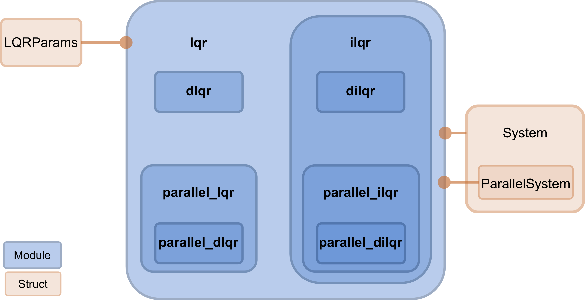

[](https://doi.org/10.5281/zenodo.14861291)
[](https://diffilqrax.readthedocs.io/en/latest/?badge=latest)


# Diffilqrax: Differentiable optimal control

## What is it?

Diffilqrax is a JAX library for LQR and iterative LQR (iLQR) optimal control. It provides:

- **Sequential and parallel solvers.** The sequential solvers use a Riccati recursion
  (`lqr.solve_lqr`, `ilqr.ilqr_solver`). The parallel solvers use an associative scan with
  O(log T) depth (`plqr.solve_plqr`, `parallel_ilqr.pilqr_solver`).
- **Robust iLQR.** It uses adaptive Levenberg–Marquardt regularisation and an Armijo line search,
  and stops based on the KKT conditions.
- **Exact implicit gradients.** `diff_lqr.dlqr`, `diff_ilqr.dilqr` and their parallel versions
  `pdlqr` and `pdilqr` define custom VJPs, so `jax.grad` differentiates the optimal trajectory
  with respect to the dynamics and cost parameters without backpropagating through the solver
  iterations.

## Installation

From a local clone, with pip:

```bash
git clone git@github.com:ThomasMullen/diffilqrax.git
cd diffilqrax
pip install -e .            # library
pip install -e ".[dev]"     # + tests and linting
pip install -e ".[doc]"     # + documentation
```

or with [uv](https://docs.astral.sh/uv/), using the committed `uv.lock`:

```bash
uv sync --extra dev
uv run pytest tests/ -m "not slow"
```

Importing diffilqrax enables JAX double precision (`jax_enable_x64`).

## Quick example

This example swings a pendulum up from hanging down to upright:

```python
import jax.numpy as jnp
from diffilqrax.ilqr import ilqr_solver
from diffilqrax.diff_ilqr import dilqr
from diffilqrax.typs import System, ModelDims, iLQRParams, PendulumParams

dims = ModelDims(n=2, m=1, horizon=100, dt=0.05)

def dynamics(t, x, u, theta):          # x = [angle, angular velocity]
    acc = -theta.g / theta.l * jnp.sin(x[0]) + u[0] / (theta.m * theta.l**2)
    return x + dims.dt * jnp.stack([x[1], acc])

def cost(t, x, u, theta):
    return 0.01 * jnp.sum(u**2)

def costf(x, theta):
    return 10.0 * ((x[0] - jnp.pi) ** 2 + x[1] ** 2)

model = System(cost, costf, dynamics, dims)
params = iLQRParams(x0=jnp.zeros(2), theta=PendulumParams(m=1.0, l=1.0, g=9.81))
Us_init = jnp.zeros((dims.horizon, dims.m))

(Xs, Us, lambdas), total_cost, cost_history = ilqr_solver(model, params, Us_init, max_iter=200)

# differentiable version: tau = [x_t, u_t], with implicit gradients w.r.t. params
tau = dilqr(model, params, Us_init, max_iter=200)
```

More examples are in the documentation notebooks (`docs/source/examples/`) and in `examples/`.

## Documentation

Build the docs locally (this also needs `pandoc`, for example `brew install pandoc`):

```bash
pip install -e ".[doc]"
make -C docs html
open docs/build/html/index.html
```

## Tests

```bash
pytest tests/ -m "not slow"   # fast suite
pytest tests/ -m slow          # large-dimension tests
```

## Design principle




## License

This project is licensed under the Apache License 2.0. See the LICENSE file for details.

## Acknowledgments

This project has received funding from the European Union’s Horizon 2020 research and innovation programme under the Marie Skłodowska-Curie grant agreement #813457.
