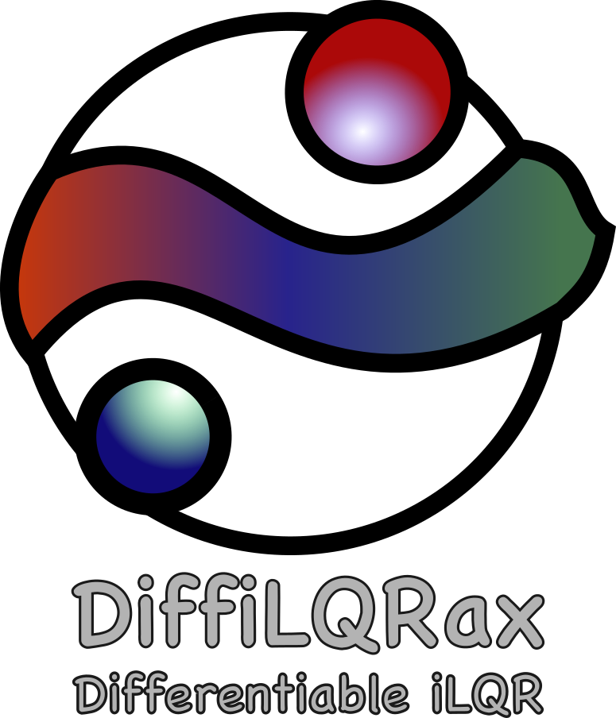
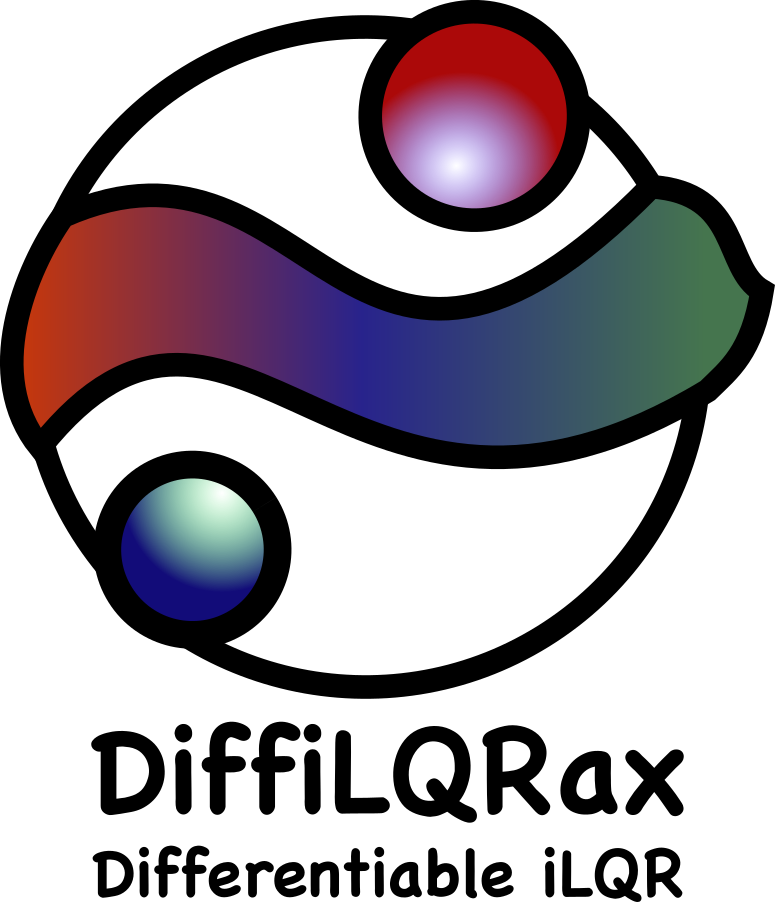

.. DiffiLQRax Documentation master file, created by
   sphinx-quickstart on Thu Dec 19 23:21:29 2024.
   You can adapt this file completely to your liking, but it should at least
   contain the root `toctree` directive.

.. rst-class:: heading-center

Welcome to DiffiLQRax!
====================================

DiffiLQRax is an open source JAX library for LQR and iterative LQR (iLQR) optimal control. It provides:

- sequential (Riccati) and parallel (associative-scan) solvers for LQR and iLQR,
- adaptive regularisation and Armijo line search, with stopping based on the KKT conditions,
- exact implicit gradients through every solver via ``jax.grad``, so a controller can be trained inside a larger model.

Please support the development of DiffiLQRax by starring or watching the project on `GitHub <https://github.com/ThomasMullen/diffilqrax>`_.

Quick Examples
--------------

Linear Quadratic Regulator (LQR)
^^^^^^^^^^^^^^^^^^^^^^^^^^^^^^^^

.. grid:: 1 2 2 2
   :gutter: 2

   .. grid-item-card::  LQR: bringing a double integrator to rest
      :link: ./examples/lqr_integrator
      :link-type: doc
      :shadow: none
      :class-card: example-gallery

      .. image:: _static/nb_thumbnails/lqr_integrator.png
         :alt: LQR regulation
         :class: gallery-thumbnail

   .. grid-item-card::  LQR tracking of a reference trajectory
      :link: ./examples/lqr_tracking_integrator
      :link-type: doc
      :shadow: none
      :class-card: example-gallery

      .. image:: _static/nb_thumbnails/lqr_tracking_integrator.png
         :alt: LQR tracking
         :class: gallery-thumbnail

Iterative LQR (iLQR)
^^^^^^^^^^^^^^^^^^^^

.. grid:: 1 2 2 2
   :gutter: 2

   .. grid-item-card::  iLQR: pendulum swing-up
      :link: ./examples/simple_pendulum
      :link-type: doc
      :shadow: none
      :class-card: example-gallery

      .. image:: _static/nb_thumbnails/simple_pendulum.png
         :alt: pendulum swing-up
         :class: gallery-thumbnail

   .. grid-item-card::  iLQR compared with gradient descent
      :link: ./examples/ilqr_vs_backpropagation
      :link-type: doc
      :shadow: none
      :class-card: example-gallery

      .. image:: _static/nb_thumbnails/ilqr_vs_backpropagation.png
         :alt: iLQR vs gradient descent
         :class: gallery-thumbnail

   .. grid-item-card::  Implicit gradients through iLQR
      :link: ./examples/gradients_through_ilqr
      :link-type: doc
      :shadow: none
      :class-card: example-gallery

      .. image:: _static/nb_thumbnails/gradients_through_ilqr.png
         :alt: implicit vs direct gradients
         :class: gallery-thumbnail

   .. grid-item-card::  Parallel (associative-scan) solvers
      :link: ./examples/parallel_solvers
      :link-type: doc
      :shadow: none
      :class-card: example-gallery

      .. image:: _static/nb_thumbnails/parallel_solvers.png
         :alt: parallel solvers
         :class: gallery-thumbnail

   .. grid-item-card::  iLQR inference: reconstructing a zebrafish tail bout
      :link: ./examples/zebrafish_tail_reconstruction
      :link-type: doc
      :shadow: none
      :class-card: example-gallery

      .. image:: _static/nb_thumbnails/zebrafish_tail_reconstruction.png
         :alt: zebrafish tail reconstruction
         :class: gallery-thumbnail

Installation
------------

.. code-block:: bash

   git clone git@github.com:ThomasMullen/diffilqrax.git
   cd diffilqrax
   pip install -e .        # or: uv sync

See :doc:`userguide/getting_started` for optional extras, GPU notes and a first example.

Contents
--------

.. toctree::
   :maxdepth: 2
   :caption: Contents

   userguide/getting_started
   examples/index
   userguide/design_principles
   about/lqr_theory
   api/modules

Acknowledgements
================
This project has received funding from the European Union’s Horizon 2020 research 
and innovation programme under the Marie Skłodowska-Curie grant agreement #813457.